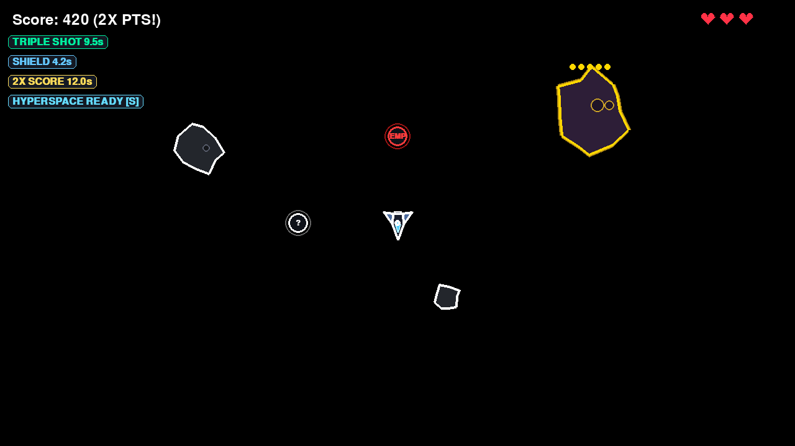

<div align="center">

# 🚀 Asteroids (Pygame)

An arcade space combat game built with Python 3.13+ and Pygame, featuring vector inertia, tactical forward warp leap, procedural asteroid waves with 30s lifecycles, golden skill drops, 8 dynamic power-ups, and a persistent SQLite leaderboard.

[](https://www.python.org/)
[](https://www.pygame.org/)
[](https://github.com/astral-sh/uv)
[](https://github.com/astral-sh/ruff)
[](https://github.com/DetachHead/basedpyright)
[](LICENSE)

---

<p align="center">
  
</p>

---

</div>

## 🌌 Overview

**Asteroids** is a modernized recreation of the classic vector arcade shooter. Pilot a rocket ship through a dense, tumbling asteroid field. Engage thrusters with authentic space drift, fire high-speed lasers, blast 5-HP golden asteroids to claim power-up skill drops, execute tactical forward hyperspace jumps, and record your top pilot records to a persistent local SQLite leaderboard.

---

## ✨ Features

- **🚀 Rocket Ship Aerodynamics & Drifting:** Ice-like inertia physics with animated dual thruster plasma fire and lingering smoke exhaust particles.
- **⚡ Tactical Forward Hyperspace Jump:** Press <kbd>S</kbd> to execute an emergency 260px forward warp leap with a 20-second cooldown and temporary buffer shield.
- **☄️ Dynamic Asteroids & Wave Mechanics:**
  - Cap of up to 40 active asteroids on screen.
  - 30-second Time-to-Live (TTL): asteroids loop around the screen for 30s, after which they naturally disappear upon leaving screen bounds to introduce fresh waves.
  - Procedural tumbling geometry and fragmentation when shot.
- **🌟 Rare Golden Asteroids (15% Spawn Rate):**
  - Distinctive radiant golden aura and overhead 5-segment HP bar.
  - Require 5 hits to destroy and disintegrate directly into nothing without debris clutter.
- **💎 8 Collectible Power-Up Skills:**
  - **Triple-Shot (`3X`)**: 3-way spread lasers (forward, +45°, -45°) for 15s.
  - **Rapid Fire (`RF`)**: Doubles firing rate (cooldown halved) for 15s.
  - **Invincibility (`★`)**: Complete damage immunity with a pulsing celestial shield for 5s.
  - **EMP Bomb (`EMP`)**: Instantly detonates a screen-wide shockwave destroying or splitting all asteroids in play.
  - **Homing Missiles (`HM`)**: Laser projectiles seek out and curve towards the nearest asteroid for 12s.
  - **Slow Motion (`SLOW`)**: Time dilation slowing all asteroids down by 50% while your ship moves and fires normally for 10s.
  - **Double Score (`2X`)**: Doubles all points earned for 20s.
  - **Magnet (`MAG`)**: Pulls floating power-up orbs towards your ship across deep space for 15s.
- **❤️ 3 Lives & Damage Flash:** Heart-based HUD with invulnerability damage flash upon impact.
- **🏆 Top Pilots Leaderboard:** SQLite-backed high scores table with pilot callsign entry on the welcome and game over screens.
- **⏸️ Pause System:** Press <kbd>P</kbd> or in-game <kbd>Esc</kbd> to pause the game at any moment.

---

## 🎮 Controls

| Action | Key | Description |
| :--- | :---: | :--- |
| **Rotate Left** | <kbd>A</kbd> / <kbd>←</kbd> | Turn ship counter-clockwise |
| **Rotate Right** | <kbd>D</kbd> / <kbd>→</kbd> | Turn ship clockwise |
| **Thrust Forward** | <kbd>W</kbd> / <kbd>↑</kbd> | Accelerate in the facing direction |
| **Forward Hyperspace Warp** | <kbd>S</kbd> / <kbd>↓</kbd> | 260px tactical forward leap (20s cooldown) |
| **Fire Blasters** | <kbd>Space</kbd> | Shoot high-speed laser projectile |
| **Pause / Resume** | <kbd>P</kbd> or <kbd>Esc</kbd> | Pause or resume gameplay |
| **Launch Game** | <kbd>Enter</kbd> | Start game from welcome menu |
| **Quit Game** | <kbd>Esc</kbd> (in menu/paused) | Exit to desktop |

---

## 📦 Project Structure

```text
Asteroids/
├── assets/
│   ├── icon.png                  # Custom window icon
│   └── gameplay_screenshot.png   # In-game preview screenshot
├── src/
│   └── asteroids/                # Core game package
│       ├── __init__.py           # Package exports
│       ├── asteroid.py           # Asteroid entity, procedural vertices, HP & TTL
│       ├── asteroidfield.py      # Procedural edge-spawner & wave cap manager
│       ├── circleshape.py        # Base 2D sprite class with circle collision logic
│       ├── constants.py          # Physics, dimensions, cooldowns, and skill timings
│       ├── logger.py             # Event & state JSONL telemetry recorder
│       ├── main.py               # Game controller, states (MENU, PLAYING, PAUSED, GAMEOVER), HUD
│       ├── player.py             # Rocket ship model, inertia, skills, forward warp leap
│       ├── powerup.py            # 8 collectible floating skill orbs with screen looping
│       ├── repository.py         # SQLite high scores persistence & pilot callsigns
│       └── shot.py               # Laser projectile entity with homing tracking
├── main.py                       # Top-level launch script
├── pyproject.toml                # Project metadata, dependencies, build-system & tool configs
└── uv.lock                       # Deterministic lockfile
```

---

## 🛠️ Getting Started

### Prerequisites

- [Python 3.13+](https://www.python.org/downloads/)
- [`uv`](https://docs.astral.sh/uv/getting-started/installation/) *(recommended)* or standard `pip`

### Installation

1. **Clone the repository:**
   ```bash
   git clone https://github.com/CFMVCarlos/Asteroids.git
   cd Asteroids
   ```

2. **Install dependencies:**
   ```bash
   uv sync
   ```

---

## 🚀 Running the Game

Launch the game with `uv`:

```bash
uv run main.py
```

---

## 🧪 Code Quality & Development

The repository enforces strict code quality, linting, docstrings, and static type checking:

```bash
# Format and lint check
uv run ruff format
uv run ruff check --fix

# Static type checking
uv run basedpyright
```

---

## 👤 Author

- **Carlos Valente** – [GitHub (@CFMVCarlos)](https://github.com/CFMVCarlos)
- Built as part of the [Boot.dev](https://www.boot.dev) Python / Game Development curriculum.
